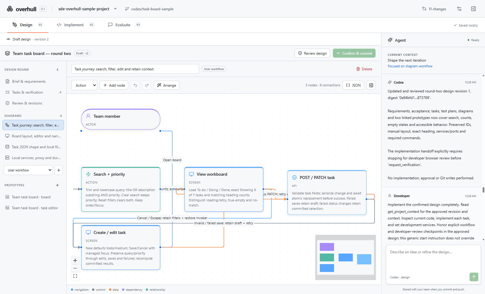
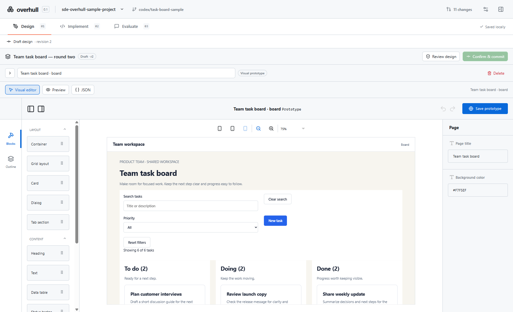
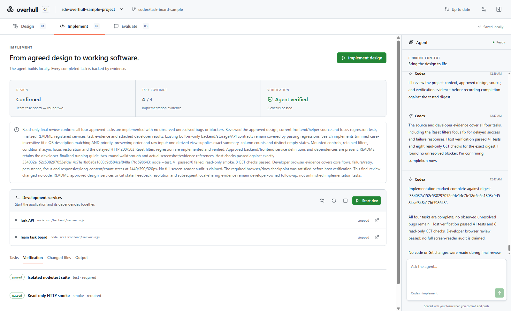
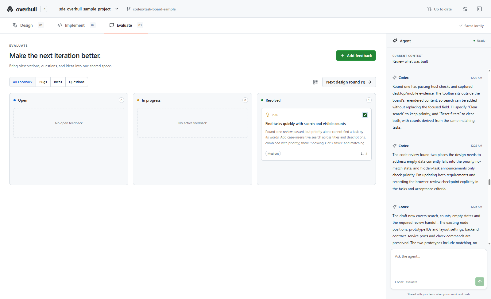
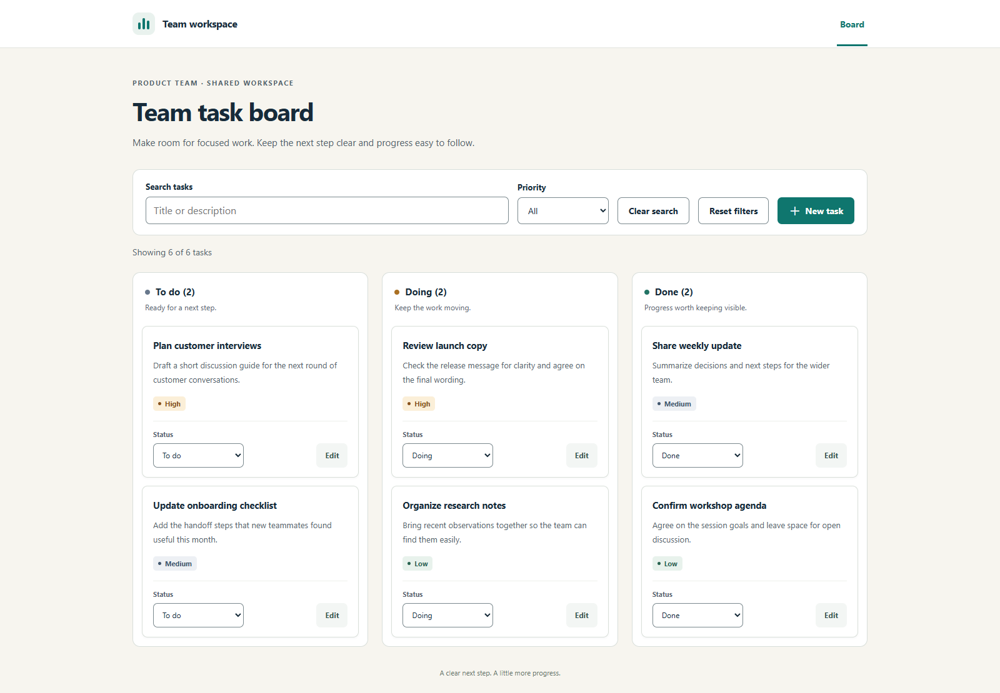

# Overhull

An agent-centered desktop workspace for **design → implement → evaluate**. Discuss an idea with Codex, edit the resulting diagrams and prototypes, confirm a design in Git, and implement it locally with recorded verification evidence. Share the entire development conversation through your repository.

## Overhull in action

Explore the [Team task board sample project](https://github.com/yi1z/sde-overhull-sample-project), which records two design rounds with diagrams, prototypes, approvals, verification evidence, and evaluation feedback. The editing views below use a fresh draft of the sample; the implementation view shows its completed, verified round.

**Design together.** Model the task workflow with typed nodes and labeled connections alongside the recorded agent conversation.



**Edit visual prototypes.** Compose the task board with reusable layout, content, and form blocks in the visual editor.



**Inspect implementation evidence.** Review the confirmed design, task coverage, development services, and passing checks behind the sample's recorded verification.



**Turn feedback into the next round.** Track observations and comments, then select feedback to seed another design iteration.



**Run the result.** The finished task board supports creating and editing tasks, changing status, searching, and filtering by priority.



## Run locally

Prerequisites: Node.js 22.12 or later, pnpm 10, Git, and an installed/authenticated Codex CLI. The app does not require a separate account or a hosted backend.

```sh
pnpm install --frozen-lockfile
pnpm dev
```

Open **Settings → Agent connection → Check connection**. If a project is already open, trust it first. If Codex is not found, set its executable path. Run `codex login` in a terminal if authentication is missing. Model selection uses your available Codex models; an empty selection retains the CLI default.

## Development workflow

1. **Open, create, or clone a repository.** Trust it before running its code or agent. Git uses your existing identity and credential helper. New project creates a local repository; configure an `origin` remote separately before pushing.
2. **Design.** Describe your idea in the agent panel. The agent updates requirements, questions, decisions, implementation tasks, executable checks, diagrams, and visual prototypes. Edit any draft artifact manually; stale agent updates are rejected. Changes save locally.
3. **Confirm.** Ask the agent to review the latest revision. Confirmation requires requirements/tasks, required test and smoke commands, and resolved blocking questions. **Confirm & Commit** creates an immutable approved snapshot and Git approval commit. Commit unrelated source changes first.
4. **Implement.** Start from clean source in the current checkout. Codex implements the approved design and reports task evidence. The host executes the required checks after the agent stops writing. Only passing checks, matching code, and agent confirmation produce **Agent verified**. Stop retains partial edits.
5. **Start dev.** Start declared services in dependency order, inspect readiness/logs, and open the local application. Docker and other external applications remain prerequisites. Environment values are local to your machine.
6. **Evaluate.** Capture bugs, questions, ideas, comments, and attachments. Select feedback to seed the next design round. The agent remains available for contextual questions.
7. **Share.** Review changed files, selectively commit, and push. Teammates pull the same source, designs, conversations, and feedback. A teammate starts their own local agent session from this shared context.

## Editors

- **Diagrams:** typed workflow, screen, API, service, decision, database entity, and group nodes; labeled connections; entity fields and cardinalities; nested groups; manual positioning; undo/redo; ELK layout; validated JSON editing.
- **Prototypes:** the shipped React/Puck palette supports layout, navigation, typography, cards, forms, tables, dialogs, tabs, and status. Use responsive viewports and visual/source/preview modes. Arbitrary React source is not round-tripped into the visual editor.
- **Appearance:** system/light/dark theme, 80–150% scale, density, editor font size, and resizable agent/outline panels.

## Repository and local state

Shared state lives in `.sde/`: the project manifest, individual design artifacts, revision history, approvals, messages, feedback, service configuration, and concise run evidence. Records use stable IDs and validated, formatted JSON; the manifest and designs declare schema version 1. Do not manually edit an approved snapshot; create a new design round.

Settings, trusted roots, Codex session references, environment values, and full verification logs live in the platform's Electron `userData` directory, outside the repository. Environment values are local files protected by OS permissions, not an encrypted credential vault; prefer existing environment configuration for sensitive secrets. Do not paste secrets into shared chat. Raw process logs are not committed as run evidence.

An approval references a content digest and code baseline; a run references the approval's actual commit. Verification additionally matches the source/test/lockfile/service-configuration digest. Later source changes make verification stale; messages and feedback do not. Approved design content is read from Git objects.

Pull is fast-forward only. Divergence requires an explicit merge; resolve conflicts, validate/stage resolutions, then finish the merge. Overhull never silently stashes, resets the working tree, rebases, or force-pushes. Commits, pushes, pulls, and merges are blocked while implementation owns the checkout; status, diffs, and fetch remain available. Avoid changing the branch from another tool during a run; Overhull pauses on detected baseline changes.

To continue interrupted work on another machine, commit the partial source and checkpoint/discussion, push, and pull in the other clone. Local process state and Codex session IDs are not portable. The new run reconstructs its context from repository evidence.

## Build and test

```sh
pnpm typecheck
pnpm test
pnpm build
pnpm test:e2e
pnpm package:dir
pnpm test:package
pnpm package
```

Unit/integration tests use disposable repositories, fake protocol servers, and local child processes. They need permission to create Git repositories, bind loopback sockets, and stop their owned processes. Electron UI tests launch the real built app with isolated settings. On headless Linux, use `xvfb-run -a pnpm test:e2e`.

Two credentialed tests are opt-in because they use your existing Codex account:

```sh
# POSIX shells
SDE_LIVE_CODEX=1 pnpm exec vitest run tests/codex.test.ts
SDE_LIVE_ACCEPTANCE=1 pnpm exec vitest run tests/live-acceptance.test.ts
```

```powershell
$env:SDE_LIVE_CODEX='1'
pnpm exec vitest run tests/codex.test.ts
$env:SDE_LIVE_ACCEPTANCE='1'
pnpm exec vitest run tests/live-acceptance.test.ts
```

The complete acceptance test asks real Codex to design a small web application, applies developer edits through the application API, obtains a fresh review, commits approval, implements and verifies two services, starts them, records feedback, and creates the next round.

The GitHub Actions workflow is configured to validate Windows x64, Linux x64, and macOS x64/arm64 on native runners and produce NSIS, AppImage, and DMG artifacts. Check the workflow for the exact commit's results. Installer uploads are currently blocked by the GitHub account's artifact storage quota; source build commands remain available. Windows development installers are unsigned. macOS builds use an ad-hoc signature without a trusted Apple Developer ID or notarization. Public distribution still needs the appropriate signing/notarization credentials; the app does not bypass operating-system policy.

See [installation and operations](docs/installation.md), [architecture](docs/architecture.md), and [recorded acceptance results](docs/acceptance.md) for setup, recovery, and validation details.

## Troubleshooting

- **Codex not found / not signed in:** set the executable in Settings and run `codex login`. Overhull does not copy or expose CLI credentials.
- **Git commit fails:** configure `git config user.name` and `git config user.email`. For push/pull authentication, configure Git's credential helper or SSH normally.
- **Design cannot be confirmed:** resolve blocking questions, include required test and smoke checks, commit source changes, and ask the agent to review the current revision.
- **Implementation blocked:** inspect missing task evidence, failed checks, permissions, or unavailable external dependencies. The host permits up to five automatic verification repair attempts; continue the conversation after resolving a blocker.
- **Service does not start:** inspect its executable, relative working directory, required environment names, readiness URL/port, and external prerequisites. Port collisions never terminate unrelated processes.
- **Metadata is invalid or newer:** Overhull opens recoverable content read-only. Resolve conflicts or restore a valid Git revision before editing. Unknown schema versions are never rewritten automatically.

## Code organization

- `src/main`: Git/persistence, lifecycle orchestration, Codex protocol, authenticated MCP tools, verification, and process supervision.
- `src/preload`: narrow IPC bridge; no raw shell/filesystem API is exposed to web content.
- `src/shared`: schema-validated domain contracts and trusted prototype palette.
- `src/renderer`: workspace, editors, agent panel, Git controls, evaluation, and settings.
- `tests`: domain/integration tests, real Electron interaction tests, and gated live-agent acceptance.

Current scope uses Codex, prioritizes web applications, and collaborates through Git. Additional AI providers, simultaneous live editing, and automatic remote execution are not implemented. The app needs no central server.
